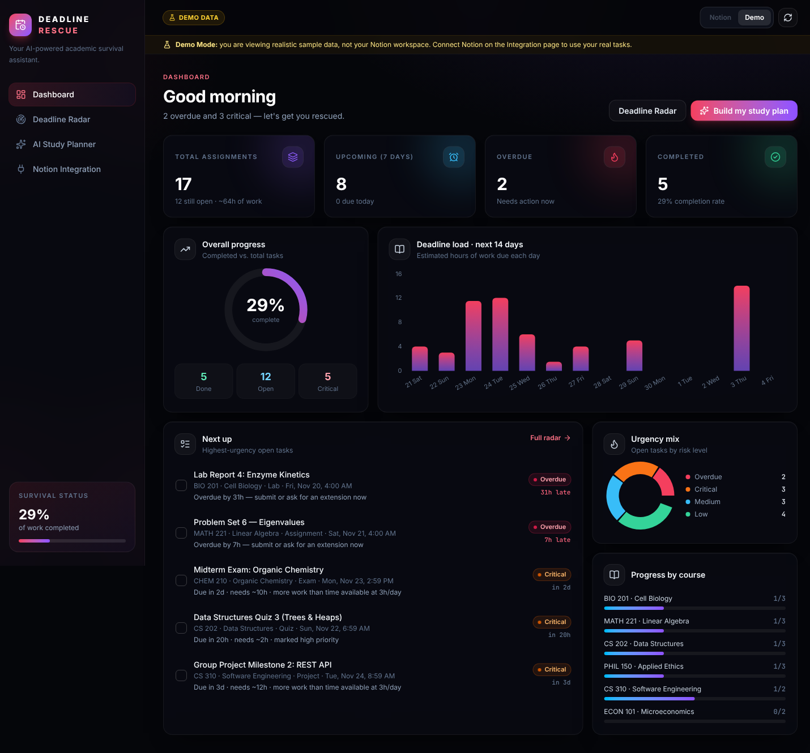
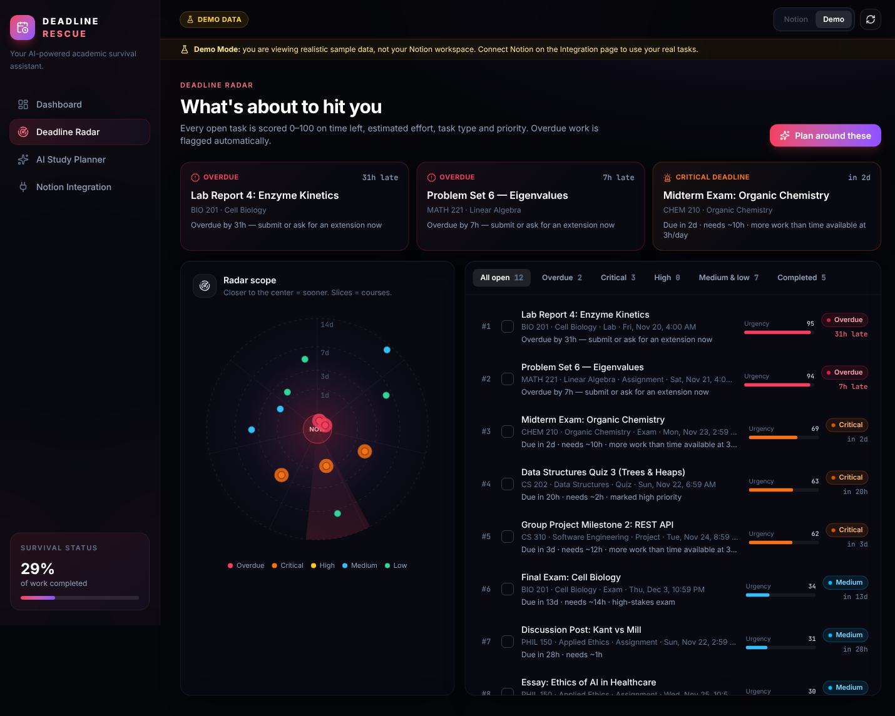
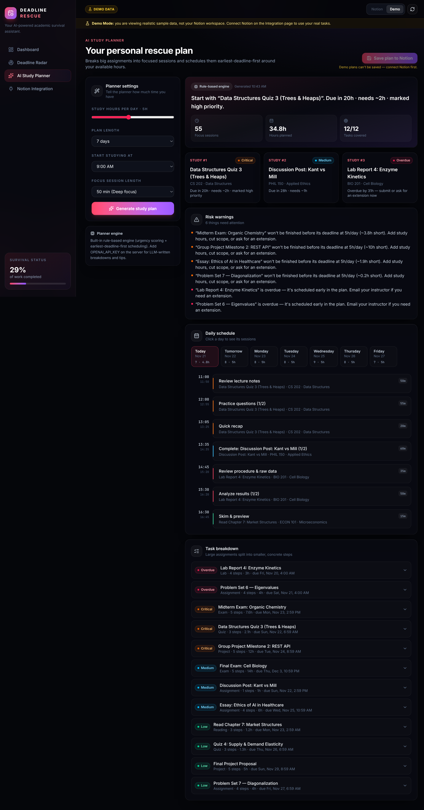

# DEADLINE RESCUE

**Your AI-powered academic survival assistant.**

University students juggle assignments, quizzes, exams, labs and group projects whose deadlines pile up on the same week. DEADLINE RESCUE connects to your **Notion Student OS**, figures out what is overdue and what is about to hit you, and builds a realistic day-by-day study plan that you can save straight back to Notion.



---

## Features

| Area | What it does |
| --- | --- |
| **Dashboard** | Total assignments, upcoming (7 days), overdue and completed counts; completion ring; 14-day deadline-load chart; urgency mix; progress per course; "next up" list with one-click completion. |
| **Deadline Radar** | Scores every open task 0–100 (time left, estimated effort vs. available study time, task type, priority). Overdue work is detected automatically; critical deadlines are highlighted in alert cards and on an animated radar (closer to the centre = sooner, slices = courses). Filterable ranked list. |
| **AI Study Planner** | Generates a daily schedule of focus sessions around your available hours (hours/day, start time, session length, plan length). Breaks big assignments into concrete sub-steps (e.g. *Read the brief → Work through questions → Draft → Review*), recommends what to study first, and warns when a task can't fit before its deadline. Optional LLM layer writes task-specific steps and coaching tips. |
| **Notion integration** | Uses the **official Notion API** (`@notionhq/client`). Auto-detects your assignments database and its properties, reads real tasks and deadlines, marks tasks done/undone in Notion, and saves the generated plan as a new Notion page (to-do blocks per session). |
| **Demo Mode** | Realistic sample semester (overdue, imminent and future work) when no Notion credentials are configured. Demo data is badged **"Demo data"** everywhere with a banner; live data is badged **"Live Notion"**. Demo plans can't be "saved to Notion" — nothing is faked. |

<p>
  
  
</p>

---

## Tech stack

- **Frontend:** React 19, Vite, Tailwind CSS v4, Recharts, React Router, Lucide icons
- **Backend:** Node.js 22 + Express 5 (keeps secrets server-side, talks to Notion), helmet, rate limiting
- **Integrations:** Official Notion API (`@notionhq/client` v5, data-sources API), optional OpenAI-compatible Chat Completions API
- **Tests:** Vitest + Supertest

## Architecture

```
Browser (React)  ──/api──▶  Express server  ──▶  Notion API (official SDK)
   no secrets               reads .env          └▶ optional LLM API
                            urgency engine
                            planner engine
                            demo data
```

```
server/
  index.js          start-up; serves the built frontend in production
  app.js            REST API routes, security middleware, error handling
  config.js         reads environment variables (server only)
  lib/notion.js     Notion client: DB auto-detection, schema mapping, updates, saving plans
  lib/urgency.js    urgency scoring + dashboard statistics
  lib/planner.js    task breakdown + day-by-day scheduler
  lib/ai.js         optional LLM sub-steps and tips (falls back to rule-based engine)
  lib/demoData.js   Demo Mode sample semester
  lib/taskModel.js  normalized task shape
src/
  pages/            Dashboard, Radar, Planner, NotionPage
  components/       Layout, TaskRow, DataGate, UI primitives
  context/          DataContext (source switching, tasks, plan, toasts)
tests/              unit tests (engine, Notion mapping with mocked SDK) + API tests
```

---

## Quick start

Requirements: **Node.js 22** (`nvm use` reads `.nvmrc`) and npm.

```bash
git clone https://github.com/jasinAnishaa2005/Deadline-Rescue.git
cd Deadline-Rescue
npm install
cp .env.example .env     # optional — leave empty to run in Demo Mode
npm run dev              # API on :3001, web app on http://localhost:5173
```

Open http://localhost:5173. Without a Notion token the app runs in **Demo Mode**.

### Scripts

| Command | Description |
| --- | --- |
| `npm run dev` | API (auto-restarts) + Vite dev server with `/api` proxy |
| `npm test` | Run the unit and API test suites |
| `npm run build` | Build the frontend into `dist/` |
| `npm start` | Production: Express serves the API **and** `dist/` on `PORT` |

---

## Connecting your Notion Student OS

1. **Create an internal integration** at <https://www.notion.so/profile/integrations> → *New integration*. Give it **Read content**, **Update content** and **Insert content** capabilities and copy the *Internal Integration Secret*.
2. **Share your Student OS with the integration.** Open the Student OS page (or directly its Assignments/Tasks database) → `•••` → **Connections** → add your integration. Child pages and databases inherit access.
3. **Configure the server** in `.env`:
   ```bash
   NOTION_TOKEN=ntn_xxx                         # required
   NOTION_ASSIGNMENTS_DATABASE_ID=<id or URL>   # optional, auto-detected otherwise
   NOTION_PLANS_PARENT_PAGE_ID=<id or URL>      # optional, where plans are saved
   ```
4. **Restart** `npm run dev`, click **Notion** in the top bar (or *Use live Notion data* on the Notion Integration page).

### Supported database shapes

DEADLINE RESCUE works with typical Student OS / assignment-tracker templates and auto-detects property names:

| Meaning | Detected from | Required |
| --- | --- | --- |
| Title | the title property | yes |
| Deadline | date property named like *Due*, *Deadline*, *Date* (or a date formula) | yes |
| Done / status | `status` property (uses Notion's *Complete* group), checkbox named *Done/Completed*, or select named *Status* | recommended |
| Course | relation (titles are resolved), select, multi-select, text, rollup or formula named *Course/Class/Subject/Module* | no |
| Type | select named *Type/Category* (exam, quiz, project, lab, reading, assignment) — otherwise inferred from the title | no |
| Priority | select/number named *Priority/Importance* | no |
| Estimated hours | number named *Estimate/Effort/Hours/Duration* | no (defaults by type) |

If detection guesses wrong, set `NOTION_PROP_TITLE`, `NOTION_PROP_DUE`, `NOTION_PROP_STATUS`, `NOTION_PROP_COURSE`, `NOTION_PROP_TYPE`, `NOTION_PROP_PRIORITY` or `NOTION_PROP_EFFORT`. Database auto-detection picks the first shared database whose name contains *assignment, task, homework, deadline, coursework* or *to-do*; the Notion Integration page lists every database the integration can see.

**Date-only deadlines** are treated as due at 23:59 in your browser's time zone.

### What gets written to Notion

- **Marking a task done** updates that page's status (to an option in the *Complete* group), checkbox or select.
- **Save plan to Notion** creates a page *"Deadline Rescue Study Plan — YYYY-MM-DD"* under `NOTION_PLANS_PARENT_PAGE_ID` (or the page that contains your tasks database, or else a page shared with the integration) with a summary callout, "study these first", warnings and a to-do per study session.

Nothing else is modified.

---

## AI Study Planner

The planner always runs a deterministic engine so it works offline and never invents data:

1. **Urgency scoring** — time left, estimated effort vs. study time available (3h/day), task type weight, priority. Overdue tasks score 90–100.
2. **Breakdown** — each task is split into type-specific steps (exam: *map syllabus → review concepts → practice problems & past papers → drill weak areas → final recap*; project: *scope → plan → build → test & document → submit*; …) sized to its estimated hours.
3. **Scheduling** — earliest-deadline-first into focus sessions with breaks, capped per task per day to keep days varied, never after a deadline has passed; overdue work is kept near the top.
4. **Warnings** — tasks that won't fit before their deadline at your hours/day, and overdue tasks.

**Optional LLM:** set `OPENAI_API_KEY` (and optionally `OPENAI_MODEL`, `OPENAI_BASE_URL` for any OpenAI-compatible provider). The LLM then writes task-specific sub-steps and three coaching tips; the scheduler still decides the timing. If the call fails, the app falls back to the built-in engine and tells you.

---

## Security

- All credentials live in the server's environment (`.env`, git-ignored). The frontend never receives them — the browser only calls the local `/api`.
- `GET /api/status` only reports *whether* Notion/AI are configured, never the values (covered by a test).
- `helmet` security headers + CSP, JSON body limit, and API rate limiting (120 req/min).
- The Notion integration can only access pages you explicitly share with it.

## API reference

| Method & path | Purpose |
| --- | --- |
| `GET /api/status` | Which integrations are configured |
| `GET /api/notion/connection` | Detected database + property mapping |
| `GET /api/notion/databases` | Databases shared with the integration |
| `GET /api/tasks?source=demo\|notion&tz=<offset>` | Tasks with urgency scores + dashboard stats |
| `PATCH /api/tasks/:id` `{completed, source}` | Mark done / not done (writes to Notion for live data) |
| `POST /api/plan` `{source, days, hoursPerDay, startHour, sessionMinutes, useAi, tzOffsetMinutes}` | Generate a study plan |
| `POST /api/plan/save` `{plan}` | Save a Notion-sourced plan as a Notion page |
| `POST /api/demo/reset` | Reset demo data |

## Testing

```bash
npm test
```

- `tests/engine.test.js` — task normalization, config parsing, urgency scoring, statistics, breakdown and scheduling rules.
- `tests/notion.test.js` — schema detection and page mapping using official Notion API response shapes; service flows (auto-detect, pagination, relation lookup, status updates, plan saving, error mapping) against a mocked SDK client.
- `tests/api.test.js` — REST endpoints with Supertest, including "demo plans can't be saved", secret non-disclosure and LLM fallback.

## Troubleshooting

| Message | Fix |
| --- | --- |
| *Notion rejected the integration token* | Check `NOTION_TOKEN`; restart the server. |
| *No databases are shared with your integration* | In Notion: `•••` → Connections → add the integration to your Student OS. |
| *Could not auto-detect your assignments database* | Set `NOTION_ASSIGNMENTS_DATABASE_ID` (ID or URL). |
| *has no date property for deadlines* | Add a *Due Date* date property or set `NOTION_PROP_DUE`. |
| *Could not find a Notion page to save the plan under* | Share a page (not only the database) with the integration, or set `NOTION_PLANS_PARENT_PAGE_ID`. |

## Roadmap

- OAuth public integration (multi-user) instead of an internal token
- Calendar export (ICS) and reminders
- Code-splitting the chart bundle
